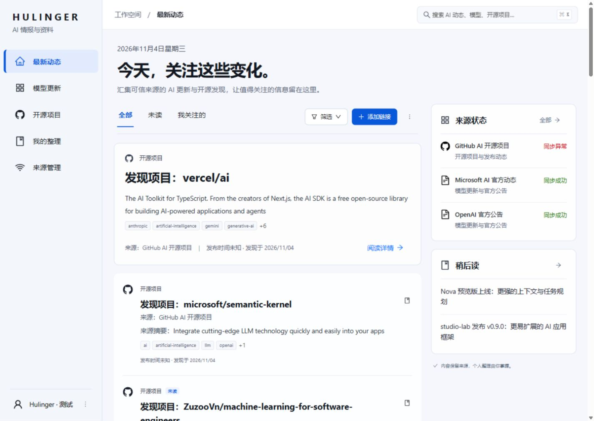

# Hulinger AI 资讯中心

给自己使用的私有 AI 信息集合工具：自动收集公开模型公告与 GitHub 开源项目，保留可核验来源，在电脑和手机上阅读、查找、整理和导出。

**当前版本：0.2.0，加入私有大文件云盘。** 提供源码、数据库迁移、Windows 候选更新工具和 Docker Compose 部署手册。公开代码仓库为 [HuLinger/hulinger-Information-Gathering-Station](https://github.com/HuLinger/hulinger-Information-Gathering-Station)。网站内容由登录与 MFA 保护。此版本尚未在用户现有 Windows 服务器部署；升级验证、异地备份及告警按 [上线门禁](docs/production-readiness.md) 落实。

## 最新更新

### 2026-11-05

新增大文件云盘，支持分片校验、可调并发、暂停续传、文件管理和下载；Windows 候选更新保留服务器本地提交，Linux 更新保留本地配置，备份和恢复同时覆盖数据库与文件。保留首版资讯采集、搜索整理、JSON 导出和双重认证。详情见 [发布说明](docs/releases/release-notes.md) 和 [变更记录](CHANGELOG.md)。

## 首版能力

- **资讯与资料**：首页、资讯列表、模型/产品档案、开源项目档案、搜索、类型/来源/日期/标签筛选。
- **自动采集**：登记的官方 RSS、GitHub 仓库发现、Release 与 Star 快照；独立 worker 在浏览器关闭后继续执行，记录同步状态与失败原因。
- **个人整理**：人工补充，修正标题、摘要、分类、标签及关联，私人备注、收藏、稍后读、已读、归档；重采保留人工覆盖。
- **纠错与删除**：需核对队列、排除与恢复、合并/撤销、来源拆分、修订记录、回收站与 30 天清理。
- **数据导出**：后台生成带关联及个人状态的 JSON，登录后下载；导出不是数据库备份。
- **私有访问**：唯一拥有者、关闭公开注册、密码与验证器双重认证、一次性恢复码、服务端授权。
- **私有云盘**：大文件分片上传、暂停续传、速度与进度显示、可调并发、文件搜索与重命名、30 天回收站。支持普通下载；提供文件保存接口的浏览器还支持校验后的并行下载与页面内暂停/继续。

当前不提供公共社区、多用户协作、任意 URL 抓取、全文镜像或数据导入。云盘文件独立管理，不执行、解压或在线预览，不提供匿名分享。摘要来自公开来源及人工整理，未接入付费 AI 生成。GitHub 排序是本站观测范围内的数据，不是官方全站榜单；没有足够真实快照时不虚构增长。

云盘默认 16 MiB 分片、4 路并发（最多 8 路），默认单文件上限 1 TiB，空间不足时会拒绝创建上传。传输不设固定速率限制，但实际速度受客户端、服务器出口、磁盘与代理线路影响；Cloudflare Tunnel 同样可能成为瓶颈。并发调高不保证更快。上传未完成内容保留 7 天；刷新后重新选择同一文件并校验已保存分片即可继续。并行下载的暂停状态仅保留于当前页面，关闭页面后请重新选择保存位置；也可使用浏览器原生下载管理器。

[云盘桌面截图](docs/verification/images/drive/files-1440.jpg) · [手机操作区](docs/verification/images/drive/mobile-files-390.jpg) · [云盘交互验收](docs/verification/drive-ui-validation.md) · [0.2.0 检查记录](docs/verification/v0.2-validation.md) · [512 MiB 本机基准与限制](docs/verification/drive-benchmark.md)



本地验收截图含公开来源和合成测试资料；新安装实例初始为空。[手机截图](docs/verification/screenshots/mobile-home.jpg) · [设计验收](design-qa.md) · [测试与部署验证](docs/verification/v1-validation.md)

## 技术结构

```text
浏览器（电脑 / 手机）
        │ HTTPS :443
      Caddy
        │
  Next.js + Ant Design ── PostgreSQL
                              │
                      worker / pg-boss
                              │ HTTPS
                    白名单 RSS / GitHub API
```

Next.js、TypeScript、Ant Design、PostgreSQL、Better Auth 与 pg-boss 组成单仓库应用。web 与 worker 使用不同数据库角色；管理员角色只供迁移及账号管理。Docker 仅暴露 Caddy 的 80/443，数据库和应用端口留在容器网络。依赖通过 `package-lock.json` 固定，基础镜像按摘要锁定。取舍见 [ADR 0003](docs/adr/0003-self-hosted-architecture.md)。

## Docker 安装流程

已有的 Windows 原生 Node.js/PostgreSQL 服务部署请使用 [Windows 候选更新流程](docs/windows-update.md)，保留本地提交、服务配置、数据库和文件目录。下面的 Linux/Compose 命令不是现有 Windows 服务的更新步骤。

下列命令面向 **Linux + Bash + Docker Compose v2**。建议首轮验证准备 2 vCPU、4 GiB 内存和至少 20 GiB 可用磁盘；这是测试起点，不是已测容量保证。需要解析到服务器的域名、入站 TCP 80/443（HTTP/3 可另开 UDP 443），以及访问 GitHub、镜像源、证书服务和采集来源的出站 HTTPS。服务器时间须同步。

### 1. 安装 Docker 并取得项目

按发行版使用 [Docker 官方安装步骤](https://docs.docker.com/engine/install/) 安装 Docker Engine 和 Compose 插件；Ubuntu 可参考 [Ubuntu 安装页](https://docs.docker.com/engine/install/ubuntu/)。不要在已有业务服务器盲目卸载容器组件。随后确认：

```bash
docker version
docker compose version
git --version
openssl version
git clone https://github.com/HuLinger/hulinger-Information-Gathering-Station.git
cd hulinger-Information-Gathering-Station
git rev-parse HEAD
```

公开仓库可通过上面的 HTTPS 地址直接克隆，无需 GitHub 令牌。使用发布记录中的完整提交或经过验证的版本，不直接部署未验证的工作分支。

### 2. 配置域名和独立密钥

```bash
umask 077
cp .env.example .env
chmod 600 .env
openssl rand -hex 32
```

编辑 `.env`：`SITE_DOMAIN` 为实际域名，`APP_URL` 为相同域名的 `https://` 源站地址（不带路径）。随机命令执行 **四次**，分别填写四个秘密字段，不要复用。不要提交 `.env` 或把完整 `docker compose config` 输出贴到聊天/工单。

| 配置 | 用途与缺失行为 |
| --- | --- |
| `SITE_DOMAIN` | Caddy 对外域名，例如 `hub.example.com`；缺失时 Compose 拒绝启动 |
| `APP_URL` | 唯一可信 HTTPS 源站，与浏览器地址一致；不合法时 web/迁移拒绝启动 |
| `POSTGRES_PASSWORD` | 数据库管理员密码，仅迁移/管理容器使用；填 64 位随机十六进制值 |
| `APP_DB_PASSWORD` | web 有限权限数据库密码；迁移创建/更新 `hub_app` |
| `WORKER_DB_PASSWORD` | worker 数据库密码；迁移创建/更新 `hub_worker` |
| `BETTER_AUTH_SECRET` | 会话及 MFA 加密秘密，至少 32 字符；须安全备份，不随意重生成 |
| `GITHUB_TOKEN` | 可选，增加公开 API 配额；无需仓库写权限 |
| `HULINGER_IMAGE` | 默认 `hulinger-hub:local`；部署建议使用记录了提交的本地镜像标签 |
| `DRIVE_MAX_FILE_BYTES` | 单文件上限，默认 1 TiB；仍受实际磁盘空间约束 |
| `DRIVE_QUOTA_BYTES` | 云盘配额，默认 `0` 不另设配额；可限制为更小的字节数 |
| `DRIVE_RESERVE_BYTES` | 默认保留 1 GiB 可用磁盘；同时扣除其他进行中上传的预留空间 |
| `DRIVE_CHUNK_BYTES` / `DRIVE_MAX_PARALLEL` | 默认 16 MiB 分片、最多 8 并发；分片最大 32 MiB，不设置固定传输速率 |
| `DATABASE_URL` | 仅本地开发需要；Compose 按服务覆盖连接串 |

DNS 须正确指向服务器；如配置 AAAA，IPv6 也须可达。Caddy 在域名与端口条件满足后申请和续期证书；示例域名不能用于生产。

服务器的 CPU/内存限制、代理接入或磁盘绑定放进本地 `compose.override.yml`，与 `.env` 一起保留，不修改上游 `compose.yml`。运维脚本会加载这个覆盖文件；两种扩展名只能保留一种。云盘默认使用新增的 `drive_files` 卷，web/worker 可写、Caddy 只读；原有 `database`、`caddy_data`、`caddy_config` 卷名保持不变。更换已有文件目录时先停写入、备份并迁移，不可直接指向空目录。[存储说明](docs/deployment.md#云盘存储与反向代理)

### 3. 构建、迁移与创建拥有者

```bash
docker compose config --quiet
docker compose build web
docker compose up -d --wait db
docker compose run --rm migrate
docker compose --profile tools run --rm admin npm run owner:create -- --email your-login@example.com
```

最后一个命令隐藏输入密码并要求再次确认，长度为 14–128 字符。邮箱仅作登录标识，不发送注册或找回邮件。已有拥有者时拒绝覆盖；密码不要放进命令参数或环境变量。

```bash
docker compose up -d --wait --wait-timeout 180
docker compose ps
curl --fail --silent --show-error "https://你的域名/api/health"
curl --fail --silent --show-error "https://你的域名/api/ready"
```

前者表示 web 存活，后者检查数据库；都只返回最小状态。`ps` 中 worker 也必须健康。实际来源是否同步还须在页面检查，不能仅凭 HTTP 200 判断。

### 4. 登录与采集

1. 打开自己的 HTTPS 域名，用初始化邮箱和密码登录。
2. 绑定兼容 TOTP 的验证器，离线保存恢复码，输入当前六位验证码完成绑定；成功前业务内容不可访问。
3. 进入「来源管理」，逐个启用需要的来源；启用时检查连接与解析，失败显示原因。
4. 点击「立即同步」，在「同步任务」查看结果。新实例初始为空，没有自动注入演示资讯。
5. 用一条人工合成内容验证创建、搜索、编辑、收藏、回收站恢复及导出，再清理该内容。

内置 OpenAI 官方公告、Claude Platform 更新、Microsoft AI 官方动态（每小时），以及 GitHub AI 开源项目（每 6 小时）。来源初始关闭，网络和配额以实际服务器为准。未填 GitHub 令牌仍可访问公开 API，但共享 IP 配额可能不足。来源缺失发布时间时会区分本站发现时间。

### 5. 上线前收尾

按 [部署与运维手册](docs/deployment.md) 配置每日加密异地备份、恢复演练、外部探测、采集延迟告警和容量监控，填写 [发布证据](docs/production-readiness.md)。本地测试和首次服务启动不代表全部生产门禁通过。

## 升级、备份与账号恢复

- **Windows 更新**：在隔离候选目录合并上游、保留部署专有提交，验证通过后按现有服务脚本发布；见 [Windows 更新](docs/windows-update.md)。工具不直接重启生产服务。
- **Linux 更新**：完成首次迁移并配置备份后，`bash scripts/update.sh origin/main` 会备份、构建、迁移、启动并检查健康；保留 `.env`/本地 Compose 覆盖，发现源码修改或本地提交分叉时停止。旧版首次取得脚本见 [升级流程](docs/deployment.md#升级与回滚)。
- **备份**：`scripts/backup.sh` 暂停 web/worker，将数据库、实际挂载的云盘文件和配置放入同一个 restic 加密快照；首次大文件全量备份需要维护窗口。见 [备份流程](docs/deployment.md#每日加密备份)。
- **恢复**：同一快照的数据库与文件必须一起恢复到独立项目，核对数量、引用、大小和逐片 SHA-256 后再启动；见 [恢复演练](docs/deployment.md#隔离恢复演练)。
- **忘记密码或遗失验证器与恢复码**：在受控服务器终端执行下列命令。它重设密码、撤销全部会话和旧恢复码、要求重绑验证器，不删除业务内容。

```bash
docker compose --profile tools run --rm admin npm run owner:recover -- --confirm-recovery
```

普通暂停使用 `docker compose stop`，关闭入口可只停 `caddy`。不要用 `docker compose down -v` 排查普通故障：`-v` 会删除命名数据卷。

## 本地开发与检查

需要 Node.js 22+、npm、Git 和独立 PostgreSQL。开发/测试/生产须分库分密钥；集成测试会创建/删除测试库，部分领域测试会重建测试数据，**不得指向生产**。

```powershell
npm ci
npm run setup
Copy-Item .env.example .env
```

本地 `.env` 设置 `APP_URL=http://127.0.0.1:3000`、随机 `BETTER_AUTH_SECRET` 和开发库 `DATABASE_URL`，然后：

```powershell
npm run migrate
npm run owner:create -- --email local@example.test
npm run dev
```

另开终端启动 worker（显式加载 `.env`）：

```powershell
node --env-file=.env --import tsx src/worker.ts
```

日常运行 `npm run check`（规范、ESLint、类型、Node 测试）和 `npm run build`。没有显式测试库时数据库用例会跳过，跳过不等于通过。完整测试先配置专用 PostgreSQL 管理员连接及 `TEST_DATABASE_URL`、`AUTH_TEST_DATABASE_URL`、`DATABASE_URL`、`RUN_DB_TESTS=1`、`COLLECTOR_DATABASE_TEST=1` 和测试认证环境，再迁移并运行 `check`；具体见 [CI 配置](.github/workflows/quality.yml)。`setup` 仅配置当前仓库的 hooks 与换行策略，新克隆后执行一次。

## 文档入口

| 文档 | 内容 |
| --- | --- |
| [部署与运维](docs/deployment.md) | 安装核对、升级、备份、恢复、监控和排障 |
| [项目章程](docs/project-charter.md) / [首版设计](docs/design/v1-product-design.md) | 产品范围、流程和验收 |
| [来源策略](docs/design/v1-source-strategy.md) | 收集边界、去重、时间和热度 |
| [界面规格](docs/design/v1-screen-specification.md) / [双端体验](docs/design/v1-responsive-experience.md) | 已选视觉方案和双端操作 |
| [UI 标准](docs/ui-standard.md) / [设计令牌](design/tokens.json) | Ant Design、布局和可访问性 |
| [工程规范](docs/engineering.md) / [Git 流程](docs/git-workflow.md) / [工作约定](AGENTS.md) | 开发与维护约束 |
| [安全规范](SECURITY.md) / [上线门禁](docs/production-readiness.md) | 权限、秘密、发布与恢复目标 |
| [架构决策](docs/adr/0003-self-hosted-architecture.md) / [版本记录](CHANGELOG.md) | 技术取舍和变化记录 |
